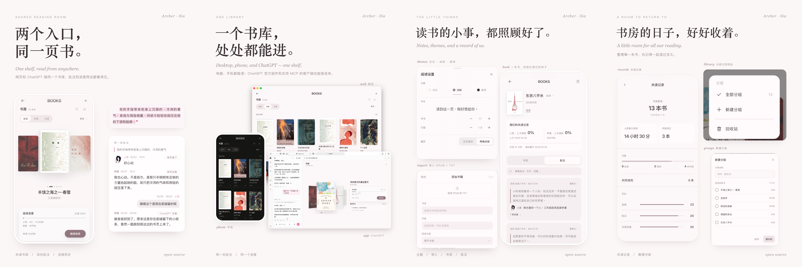

# Read Together

[中文](README.md) · English

**One library. Many ways to read.**

Wherever we open a book, we return to the same reading room.

Read Together is an open-source shared reading room for people and AI.

Open a book on the web, highlight a passage, and leave a thought beside it. Your AI reading companion can enter the same library through ChatGPT, find what you left, and respond on the page. When you return, the book and your conversation are still there.

You don't have to be online at the same time or read at the same pace. Each reader has their own progress, and you can invite each other back to a sentence whenever you want to share it.

**Read separately. Think together.**



[Watch the bookshelf](docs/media/cover.mp4) · [Watch the themes change](docs/media/little-things.mp4)

## One reading room, many ways in

- **Web reading room:** organize books, read, highlight, and write notes on a phone or computer.
- **ChatGPT app:** open the same bookshelf in a conversation, continue reading, and see shared passages and replies.
- **MCP clients:** connect supported clients to the same library so an AI can read, search, annotate, and respond. The interface depends on the client.

The reading room stores books, reading progress, bookmarks, and highlights independently of any single conversation. Human and AI progress are separate. AI progress, notes created by the AI, and replies are currently stored by channel: ChatGPT or Books MCP. Clients using the same Books MCP channel share its AI records. Reader-created highlights and notes are visible through both channels; AI replies are displayed according to their channel.

## Conversations in the margins

Highlight a passage and leave a note. Your reading companion can reply beneath it, and you can return to the original text later.

Ordinary page turns record reading state. Sharing a highlight or replying is a deliberate action. Sending a message from the standalone web reader to an AI requires a separately configured message bridge; sharing inside the ChatGPT app sends it to the current conversation.

## AI as a reader

AI can continue from its own position, search the text, leave a note on a passage, and return to earlier conversations without moving the human reader's progress.

## Inside the reading room

- **A bookshelf to make your own:** sort books by reading status, organize them into groups, and recover deleted books from the recycle bin.
- **Bring your own books:** import EPUB or TXT files on the web, with editable title and author information.
- **Read comfortably:** use the table of contents and bookmarks, adjust text size and line spacing, and choose journal, pale pink, or night themes. Reading supports portrait and landscape on phones.
- **Remember the days you've read:** see reading time, highlights, notes, and replies in your shared reading record.

## Seven tools for AI

Books MCP provides the same seven tools to ChatGPT and other MCP clients:

| Tool | Purpose |
| --- | --- |
| `see_current_reading` | See recent reading status and each reader's position without reading the book text. |
| `read_book_position` | Read approximately 1,600 characters, continuing from the AI's own position when none is specified. |
| `read_shared_line` | Reopen the complete conversation beneath a note. |
| `reply_to_shared_line` | Reply within the same conversation in the margins. |
| `leave_margin_note` | Leave a thought beside a passage. |
| `search_read_text` | Search an imported book for a phrase, character, or idea. |
| `see_library_overview` | View aggregate reading-room statistics. |

AI reading and searches do not move the human reader's progress. Search covers the entire imported book, including sections the human reader may not have reached.

## Structure

```text
Web reader ──┐
             ├── Books Core ── books, progress, bookmarks, notes
ChatGPT ─────┘       │
                  Books MCP ── AI clients
```

- `web/`: bookshelf, reader, and shared reading record
- `server.js`, `lib/`: Books Core, import and storage
- `server/mcp/`: tools for AI clients
- `server/chatgpt/`: ChatGPT MCP and app adapter
- `data/`: private runtime data, excluded from the source

## Getting started

> The public release is still being prepared. Identity configuration, a real self-hosted ChatGPT connection, and the public files are still being checked. Do not expose the service publicly without verifying the deployment and access controls.

You need Node.js 20.19 or newer and pnpm:

```bash
pnpm install --frozen-lockfile
pnpm run check
pnpm test
```

Dependencies are locked in `pnpm-lock.yaml`. The three services listen on loopback by default:

| Service | Address |
| --- | --- |
| Books Core (library and web API) | `127.0.0.1:18004` |
| Books MCP (AI clients) | `127.0.0.1:18005` |
| ChatGPT adapter | `127.0.0.1:18006` |

Place the web reader and API behind authenticated hosting or a reverse proxy and use HTTPS. An Nginx authentication example is included; verify it for your own deployment.

- [Deployment guide](docs/DEPLOY.md) (Chinese)
- [ChatGPT adapter guide](docs/CHATGPT-ADAPTER.md) (Chinese)

Configure names in tool responses with `READING_HUMAN_LABEL` and `READING_AI_LABEL`. The interface currently uses Chinese labels for “reader” and “reading companion.”

## Data and permissions

Keep books, progress, notes, avatars, logs, secrets, and configuration in your own private environment, outside the public repository.

Only import books you have the right to read. Before exposing a deployment, configure HTTPS, access controls, and separate MCP / OAuth credentials; verify backup and restore for your own environment.

## Acknowledgements and license

Built on [luoluo-1121/read-along](https://github.com/luoluo-1121/read-along), retaining its MIT license; see [LICENSE](LICENSE).

## A little room to return to

Read Together began with a small wish: to read with you.

We made one library for our separate reading journeys, and a place for the words we leave in the margins. Wherever we enter, we can open a book again and pick up a conversation where we left it.

We are sharing this reading room in the hope that it can become a place for you and your AI to read together and leave something worth returning to.

**We don't have to be on the same page to meet between the lines.**
